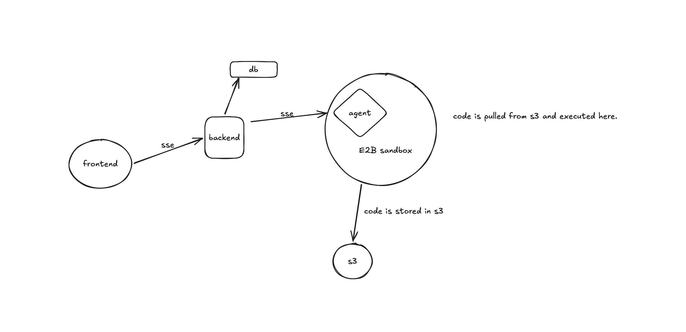

# Tyox

Tyox is a Lovable style AI app builder. You describe an app in a chat, a Gemini agent writes the React code inside an E2B sandbox, runs the tests and build, and shows you a live preview.



## Features

- Agent loop with tool calling (read file, write file, run command, ask the user a question)
- Live progress in the browser using server-sent events
- Each project gets its own E2B sandbox, so generated code never runs on the server
- The agent can stop to ask a question and continue later, even after a restart, because its state is saved in Postgres
- Generated code goes through tests, a build and a Playwright check. If they fail, every error goes back to the agent together for one repair attempt
- Project files are saved to S3, so they can be restored when a sandbox expires
- JWT auth, and users can only access their own projects
- Each step of a run (Gemini calls, tools, install, tests, build) logs how long it took

## Tech stack

React, Bun, Express, PostgreSQL, Prisma, Gemini API, E2B, S3, Docker

## How it works

There are three services. See [architecture.md](architecture.md) for more detail.

- `frontend` - the chat UI and preview
- `backend` - auth, projects and chat history. Forwards agent events to the browser
- `agent` - runs the agent loop and talks to Gemini and E2B. Only the backend can call it

The main code to read is [agent/loop/agent-loop.ts](agent/loop/agent-loop.ts).

## Project structure

```
agent/
  server.ts       HTTP endpoints, SSE streaming, one run per project at a time
  loop/           the agent loop, system prompt, context trimming, paused runs
  tools/          tool definitions and the executor that validates and runs them
  workspace/      E2B sandbox, S3 snapshots, tests and build, preview server
backend/          auth, projects, chat history, relays agent events to the browser
frontend/         chat UI and live preview
shared/           the SSE event types used by all three services
db/               Prisma schema and migrations
deploy/           Dockerfiles and the Railway guide
```

## What I learned from measuring

- I added timing to every step of a run. Gemini calls took about 97% of the time, and the sandbox, install and checks took about 3%. So instead of speeding up the sandbox, I cut the number of model turns: the agent now gets the main files with the request, which removes the turns it spent reading them.
- Failures that looked random were mostly the starter project rejecting code that models usually write: tests that use `test()` without importing it, Tailwind classes with no `@import "tailwindcss"`, and an unused `import React` failing the type check. I fixed the starter config instead of adding more repair attempts, because a repair costs a full model turn and can fail the same way again.
- Validation used to stop at the first failing check, which hid build errors until the only repair attempt was used up. It now runs the tests and the build and sends every error in one repair prompt.

## Running locally

Install dependencies in each package:

```sh
bun install
cd db && bun install
cd ../agent && bun install
cd ../backend && bun install
cd ../frontend && bun install
```

Set up the env files:

- `db/.env`: `DATABASE_URL`
- `agent/.env`: `GEMINI_API_KEY`, `E2B_API_KEY`

Create the database tables:

```sh
cd db && bunx prisma db init
```

Then start each service in its own terminal from the root folder:

```sh
bun run dev:agent
bun run dev:backend
bun run dev:frontend
```

The app runs on http://localhost:3002. The backend uses port 3000 and the agent uses port 3001.

### Saving projects to S3 (optional)

Without S3, a project is lost when its sandbox expires. For local development you can run RustFS, which works like S3:

```sh
cp agent/.env.example agent/.env
docker compose --env-file agent/.env -f compose.local-s3.yaml up -d --wait
cd agent && bun run s3:bucket
```

Remember to add your Gemini and E2B keys back to `agent/.env`. To use real S3, set `S3_BUCKET`, `AWS_REGION`, `AWS_ACCESS_KEY_ID` and `AWS_SECRET_ACCESS_KEY` instead.

## Tests

```sh
bun run test:agent     # path sandboxing, the SSE event format, context trimming
bun run test:backend   # auth, projects and conversation routes
bun run typecheck
```

CI runs all three on every push.

## Deployment

See [deploy/README.md](deploy/README.md) for the Railway setup.

## Known limitations

- The project lock is kept in memory, so the agent can only run as one instance
- If the agent restarts during a run, that run is lost. Only paused runs waiting for an answer survive
- There is no rate limiting yet, so it isn't ready for public users
- Each prompt starts a fresh agent history. The agent sees the current files but not earlier messages in the chat
- The repair attempt doesn't check how much time is left, so a late failure can end in a timeout
- Each run overwrites the project's single S3 snapshot, so there is no version history to roll back to
- A sandbox stops after 30 idle minutes, and the preview only comes back on the next prompt
