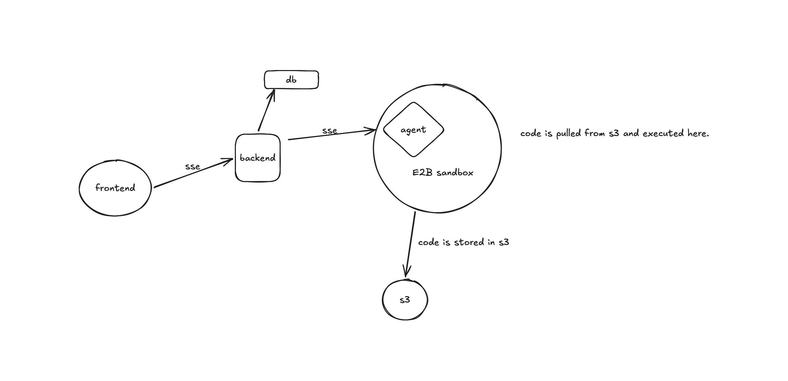

# Architecture

## What happens when you send a prompt

1. The frontend sends the prompt to the backend.
2. The backend checks that you own the project and saves the message in Postgres.
3. The backend calls the agent and streams the response back to the browser.
4. The agent loop sends the conversation to Gemini.
5. If Gemini asks for a tool, the agent validates the arguments, runs the tool in the sandbox, adds the result to the history and calls Gemini again.
6. When Gemini gives a final answer, the agent saves the project to S3, runs the tests and build, starts the preview and runs Playwright.
7. If a check fails, the error goes back to Gemini for one repair attempt.
8. The agent sends a `preview` event and a `complete` event. The backend saves the final message on the way through.

## Asking the user a question

The HTTP request can't stay open while the user thinks, so the `Qna` tool ends the run. The agent saves its history in the `agentState` column and sends a `question` event. When the user answers, the backend calls `/resume`, which loads the history, adds the answer as the result of the tool call and continues the loop.

## Where things are stored

| Data | Where | Why |
| --- | --- | --- |
| Users, projects, chat messages | Postgres | Needs to last and is relational |
| Paused agent history | Postgres (`agentState`) | Has to survive a restart |
| Project source code | S3 | Files are too big for the db and sandboxes expire |
| Running code, `node_modules` | E2B sandbox | Temporary, can be rebuilt |
| Project lock, sandbox cache | Agent memory | Only matters while the process is running |

## Security

- Generated code only runs in the E2B sandbox, and API keys are never passed into it
- File tools reject paths outside the project folder
- Tool arguments from the model are validated with Zod
- The agent API needs a shared key, and the browser never talks to it directly
- Every run has a 5 minute limit, plus limits on turns and tool calls, so a stuck model can't run forever
